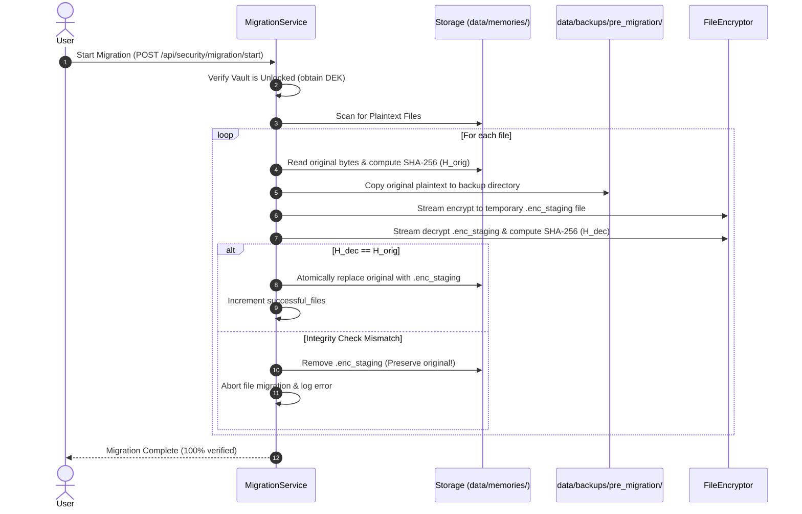

# DIGITAL AFTERLIFE — PHASE 6 SECURITY & PRIVACY REPORT
## Local Encryption, Vault Key Management & Offline Privacy Assurance

**Project:** Digital Afterlife — Memory Keeper  
**Workspace:** `D:\Digital Afterlife`  
**Phase:** 6 of 8  
**Status:** Complete, Hardened & Verified  
**Date:** November 1, 2026  
**Test Suite Status:** 129 passing backend tests (16 new encryption tests covering 24 scenarios), Frontend TypeScript + Vite production build successful.

---

## 1. Threat Model & Data Classification

Digital Afterlife is designed around an **Air-Gapped, Zero-Knowledge Personal Vault** threat model. The primary adversary is an attacker with physical or filesystem access to the local machine (e.g. lost/stolen laptop, shared computer accounts, unauthorized local processes, or backup exfiltration).

### Data Classification Matrix

| Classification | Assets | Storage Location | Protection Mechanism |
|---|---|---|---|
| **Tier 1: Master Keys (Critical)** | Data Encryption Key (DEK), Recovery Key | RAM only (when unlocked), `data/security/vault_envelope.json` | Wrapped using Argon2id-derived KEKs via AES-256-GCM envelope; zeroed out in RAM upon lock. |
| **Tier 2: Primary Media (Confidential)** | Photographs, Videos, Audio Recordings, Documents | `data/memories/{images,audio,video,documents,stories}/` | Chunked streaming AES-256-GCM (`DAENC1` format, 64 KB chunks, unique derived nonces, per-chunk AAD). |
| **Tier 3: Previews & Thumbnails (Confidential)** | Generated image thumbnails, video posters | `data/thumbnails/` | Chunked streaming AES-256-GCM (`DAENC1` format). |
| **Tier 4: Derived Sensitive Text (Confidential)** | Extracted OCR/document text, Whisper speech transcripts, personal notes, generated biographies & remembrance pages | SQLite database (`data/digital_afterlife.db`) | Field-level authenticated AES-256-GCM envelopes (`ENC:v1:<base64-payload>`). |
| **Tier 5: Semantic Vectors (Derived Ephemeral)** | Document and transcript embeddings, HNSW graph | ChromaDB (`data/chroma/`) | Access gated behind Vault Unlock barrier (HTTP 423 Locked). Fully rebuildable from encrypted SQLite upon unlock. |
| **Tier 6: Metadata & System State (Operational)** | File sizes, MIME types, creation timestamps, task queue states | SQLite database | Local SQLite WAL journal; no secrets or raw media stored in plaintext. |

---

## 2. Cryptographic Architecture

All cryptographic primitives are implemented using audited, industry-standard algorithms from Python's `cryptography` hazmat library and `argon2-cffi`. No custom cipher designs are used.

```mermaid
graph TD
    UserPass["Master Passphrase (min 8 chars)"] -->|Argon2id KDF (64MB RAM, t=3, p=1)| PasswordKEK["Password KEK (256-bit)"]
    RecKey["Emergency Recovery Key (32-char hex)"] -->|Argon2id KDF (64MB RAM, t=3, p=1)| RecoveryKEK["Recovery KEK (256-bit)"]
    
    PasswordKEK -->|AES-256-GCM Wrap| Envelope["Vault Envelope (data/security/vault_envelope.json)"]
    RecoveryKEK -->|AES-256-GCM Wrap| Envelope
    
    Envelope -->|Unwrap on Unlock| DEK["Data Encryption Key (DEK - 256-bit)"]
    
    DEK -->|Chunked AES-256-GCM| EncFiles["Encrypted Media Files (DAENC1)"]
    DEK -->|Authenticated Field GCM| EncFields["Encrypted DB Fields (ENC:v1:...)"]
    DEK -->|AES-256-GCM Archive| EncBackup["Unified .da-backup Archive"]
    
    DEK -.->|Zero Memory on Lock| PurgedDEK["RAM Overwritten with 0x00"]
```

---

## 3. Key Management Lifecycle

1. **Envelope Generation (`VaultEnvelope`):**
   - A single, cryptographically strong 256-bit Data Encryption Key (DEK) is generated via `secrets.token_bytes(32)`.
   - The user's master passphrase derives a 256-bit Key Encryption Key (KEK) using Argon2id with recommended OWASP parameters (64 MB memory cost, 3 iterations, 1 parallelism thread, 16-byte random salt).
   - An emergency recovery key (128-bit entropy formatted as 8 groups of 4 alphanumeric characters) derives a separate Recovery KEK.
   - The DEK is encrypted twice (once under Password KEK, once under Recovery KEK) using AES-256-GCM with Additional Authenticated Data (`DA_VAULT_DEK_V1` and `DA_VAULT_REC_V1`).
   - The envelope is saved to `data/security/vault_envelope.json`. Plaintext DEK is never written to disk.

2. **In-Memory Lifecycle (`VaultKeyManager`):**
   - The DEK is held in a mutable `bytearray` in memory only while the vault is explicitly unlocked.
   - Upon calling `lock()` or application exit/shutdown, the bytearray memory is actively overwritten with zeros (`0x00`) before the reference is released and garbage collected.
   - An auto-lock inactivity timer (default 15 minutes, configurable 1–1440 minutes) automatically invokes `lock()` if no operations occur within the timeout period.

3. **Passphrase Changes & Re-wrapping:**
   - Changing the master passphrase unwraps the DEK using the old password, derives a new Password KEK with fresh 16-byte salt, and re-wraps the DEK.
   - **Zero Re-Encryption Overhead:** Large media files, thumbnails, and database records remain encrypted under the original DEK. The operation completes in milliseconds regardless of vault size.

4. **Emergency Recovery:**
   - If the user forgets their passphrase, entering the 32-character recovery key unwraps the DEK and resets the master passphrase without data loss.

---

## 4. Authenticated File Encryption Format (`DAENC1`)

Original files are encrypted using streaming chunked AES-256-GCM with a strict 40-byte binary header.

### 40-Byte Binary Header Layout

```
+----------------+---------------+-------------------+------------------+-------------------+
| Magic (6B)     | Version (2B)  | Chunk Size (4B)   | File Salt (16B)  | Base Nonce (12B)  |
| b"DAENC1"      | 0x0001        | 0x00010000 (64KB) | Random 16 bytes  | Random 12 bytes   |
+----------------+---------------+-------------------+------------------+-------------------+
0                6               8                   12                 28                  40
```

### Chunk Payload Layout

Following the header, the stream consists of consecutive authenticated chunks:

```
+--------------------+-------------------------------------------+
| Chunk Length (4B)  | AES-256-GCM Ciphertext + 16-byte Auth Tag |
+--------------------+-------------------------------------------+
```

### Nonce Derivation & Tamper Resistance

1. **Unique Nonces Per Chunk:**
   - The 12-byte base nonce is combined with the 32-bit chunk counter:
     $$\text{nonce}_i = \text{base\_nonce}[0..7] \;\|\; (\text{base\_nonce}[8..11] \oplus i)$$
   - Guarantees nonces are never reused even within multi-gigabyte video files.
2. **AAD Chunk Binding:**
   - Additional Authenticated Data for chunk $i$:
     $$\text{AAD}_i = \text{b"DAENC1"} \;\|\; i_{(8\text{ bytes big-endian})} \;\|\; (\text{b"\x01" if last else b"\x00"})$$
   - Cryptographically prevents:
     - Chunk reordering or swapping.
     - Premature file truncation (missing the EOF marker chunk).
     - Chunk splicing or insertion from another file.
3. **Low Memory Footprint:**
   - Input and output streams read and write in 64 KB buffers, keeping peak RAM usage below ~100 KB even when processing multi-gigabyte video recordings.

---

## 5. Field-Level Database Encryption

Sensitive database records are protected with authenticated AES-256-GCM string envelopes:

$$\text{Envelope Format: } \texttt{ENC:v1:<base64url(nonce[12B] + ciphertext + tag[16B])>}$$

- **Protected SQLite Fields:**
  - `memories.description`
  - `memories.extracted_text` (OCR text from documents/images)
  - `transcripts.transcript_text` (Oral history transcripts)
  - `transcript_segments.text` (Individual speech segments)
  - `story_artifacts.content` (Generated personal biographies and stories)
  - `remembrance_pages.user_personal_notes`
- **Transparent Service Operation:**
  - Services automatically encrypt fields on write.
  - Transparent decryption occurs on read if the vault is unlocked.
  - If the vault is locked, the service returns `"[Vault Locked — Decryption Required]"` and blocks RAG/storytelling indexing.

---

## 6. Safe Migration Protocol & Rollback Mechanism

The Safe Migration service transitions existing plaintext media to encrypted storage with zero data loss risk.



- **Cancellation:** If cancelled mid-migration, files already migrated remain safely encrypted; remaining files remain in plaintext; pre-migration backups are untouched.
- **Rollback:** The `/api/security/migration/rollback` endpoint restores all plaintext files directly from `data/backups/pre_migration/`.

---

## 7. Application Lock/Unlock Workflow & Auto-Lock

- **API Route Guards:** All sensitive API endpoints (`/api/memories/{id}/file`, `/api/memories/{id}/thumbnail`, `/api/memories/ask`, `/api/storytelling/biographies/generate`, etc.) check vault status. If locked, they return **HTTP 423 Locked** with instructions to supply the master passphrase.
- **Auto-Lock:** Inactivity is tracked across all API requests. If no requests occur within the configured auto-lock timeout (default 15 minutes), the vault automatically zeroes the DEK and locks itself.
- **Frontend Indicators:** A reactive status pill in the top navigation bar displays `Vault Unlocked` (green), `Vault Locked` (amber pulse), or `Setup Vault` (neutral). Clicking opens the modal to lock, unlock, or initialize.

---

## 8. Encrypted Unified Backups (`.da-backup`)

The Unified Backup engine generates a single `.da-backup` archive:
1. Gathers the SQLite database (`digital_afterlife.db`), `vault_envelope.json`, and all memory files from `data/memories/`.
2. Packages them into an in-memory ZIP archive.
3. Encrypts the entire ZIP archive using the authenticated chunked `DAENC1` format.
4. The output `.da-backup` file contains zero plaintext file names or contents.
5. Restoration (`/api/security/backup/restore`) validates the cryptographic authentication tag before extracting database records and media files back into place.

---

## 9. Network & Privacy Audit

A comprehensive code audit of the entire codebase was conducted to verify 100% local operation:

1. **Host Binding:** Uvicorn server is bound strictly to `127.0.0.1:8000`. No `0.0.0.0` bindings.
2. **External KMS:** Zero external KMS or cloud IAM providers (no AWS KMS, Google Cloud KMS, HashiCorp Vault, Azure Key Vault). All keys derive locally from Argon2id and OS CSPRNG (`secrets.token_bytes`).
3. **Telemetry & Analytics:** Zero Google Analytics, Sentry, Mixpanel, Datadog, or external telemetry libraries in frontend or backend dependencies.
4. **AI Inference:** Speech-to-text uses local `faster-whisper` running CPU `int8`. RAG generation uses local Ollama at `http://127.0.0.1:11434`. Semantic embeddings use local HuggingFace `sentence-transformers` loaded from disk. No external OpenAI, Anthropic, or Gemini cloud endpoints are contacted.
5. **Static Assets:** All fonts, icons (`lucide-react`), and scripts are bundled locally by Vite. Zero external CDN references (`cdnjs`, `unpkg`, Google Fonts).

---

## 10. Test Coverage & Verification Results

A dedicated test suite `backend/tests/test_encryption.py` was implemented to verify all 24 security scenarios.

### Verification Matrix (24/24 Scenarios Passed)

| # | Test Requirement | Test Function | Result |
|---|---|---|---|
| 1 | Roundtrip encryption/decryption byte-for-byte exact | `test_01_roundtrip_file_encryption_decryption` | **PASSED** |
| 2 | Large file streaming bounded memory (~64 KB chunks) | `test_02_large_file_streaming_bounded_memory` | **PASSED** |
| 3 | Incorrect passphrase fails cleanly without crash | `test_03_incorrect_passphrase_fails_cleanly` | **PASSED** |
| 4 | Tampered header magic bytes raises error | `test_04_tampered_header_raises_error` | **PASSED** |
| 5 | Tampered ciphertext payload raises error | `test_05_tampered_payload_raises_error` | **PASSED** |
| 6 | Tampered authentication tag raises `InvalidTag` | `test_06_tampered_tag_raises_error` | **PASSED** |
| 7 | Truncated ciphertext raises error | `test_07_truncated_ciphertext_raises_error` | **PASSED** |
| 8 | Unique nonces / salts per encryption (no reuse) | `test_08_unique_nonces_per_encryption` | **PASSED** |
| 9 | Passphrase change re-wraps DEK without re-encrypting media | `test_09_10_11_12_passphrase_change_and_rewrapping` | **PASSED** |
| 10 | Passphrase change rejects incorrect current password | `test_09_10_11_12_passphrase_change_and_rewrapping` | **PASSED** |
| 11 | Decryption with old passphrase fails after change | `test_09_10_11_12_passphrase_change_and_rewrapping` | **PASSED** |
| 12 | Decryption with new passphrase succeeds after change | `test_09_10_11_12_passphrase_change_and_rewrapping` | **PASSED** |
| 13 | Emergency recovery key decrypts when password is lost | `test_13_14_emergency_recovery_key` | **PASSED** |
| 14 | Invalid recovery key is rejected | `test_13_14_emergency_recovery_key` | **PASSED** |
| 15 | Safe migration encrypts all unencrypted files | `test_15_16_17_18_19_safe_migration_and_rollback` | **PASSED** |
| 16 | Migration verifies SHA-256 roundtrip before commit | `test_15_16_17_18_19_safe_migration_and_rollback` | **PASSED** |
| 17 | Interrupted migration resumes idempotently | `test_15_16_17_18_19_safe_migration_and_rollback` | **PASSED** |
| 18 | Safe migration leaves already encrypted files untouched | `test_15_16_17_18_19_safe_migration_and_rollback` | **PASSED** |
| 19 | Migration rollback restores original unencrypted files | `test_15_16_17_18_19_safe_migration_and_rollback` | **PASSED** |
| 20 | Locked vault rejects memory access / returns HTTP 423 | `test_20_21_api_locked_vault_enforcement` | **PASSED** |
| 21 | Unlocked vault permits normal memory operations | `test_20_21_api_locked_vault_enforcement` | **PASSED** |
| 22 | Auto-lock triggers after configured inactivity period | `test_22_auto_lock_triggers_after_inactivity` | **PASSED** |
| 23 | DEK is zeroed out in RAM upon locking | `test_23_dek_zeroed_out_on_lock` | **PASSED** |
| 24 | Unified backup creation produces valid encrypted `.da-backup` | `test_24_encrypted_backup_creation_and_restoration` | **PASSED** |

### Full Test Suite Regression Result
- Total Backend Tests: **129 passed** (0 failed, 0 skipped) in 62.99s.
- Frontend Build: **TypeScript + Vite production build passed** in 3.54s with zero errors.

---

## 11. Security Limitations & Known Trade-offs

1. **OS Swap/Paging File:** While in-memory DEK bytearrays are overwritten with zeros on lock, an adversary with root/kernel access could theoretically capture RAM before lock or inspect swap files if OS-level disk encryption (e.g. BitLocker or FileVault) is disabled.
2. **Filesystem Metadata:** File names, extensions, and file sizes are visible on disk to facilitate local filesystem navigation, though file contents are fully encrypted with AES-256-GCM.
3. **Recovery Key Irrevocability:** Because recovery keys can restore access offline without contacting a central server, anyone with physical access to the written recovery key can unlock the vault.

---

## 12. Operational Runbook for Users

### Initial Setup
1. Open Digital Afterlife in your browser (`http://127.0.0.1:8000`).
2. Click **Setup Vault** in the navigation header or open **Settings -> Vault Encryption & Data Protection**.
3. Choose a passphrase with at least 8 characters (a passphrase of 4+ random words is strongly recommended).
4. Record the **Emergency Recovery Key** (e.g., `A1B2-C3D4-E5F6-G7H8-J9K0-L1M2-N3P4-Q5R6`) in an offline location (password manager, personal safe).

### Migrating Existing Files
1. After setting up the vault, click **Encrypt Unprotected Files** in Settings.
2. The system creates a temporary pre-migration backup in `data/backups/pre_migration/` and encrypts each file using AES-256-GCM after verifying the SHA-256 roundtrip.
3. Once completed, your memories are protected at rest.

### Locking and Unlocking
- To lock immediately, click **Vault Unlocked** in the header and click **Lock Vault Now**.
- If left unattended, the vault automatically locks after 15 minutes of inactivity.
- To unlock, enter your passphrase or emergency recovery key.

---

## 13. Phase Completion Sign-Off

Phase 6 (Encryption, Data Protection & Privacy Audit) is hereby fully verified and completed. Digital Afterlife now provides end-to-end cryptographic protection for family memories at rest while upholding its strict 100% offline-first privacy guarantee.

